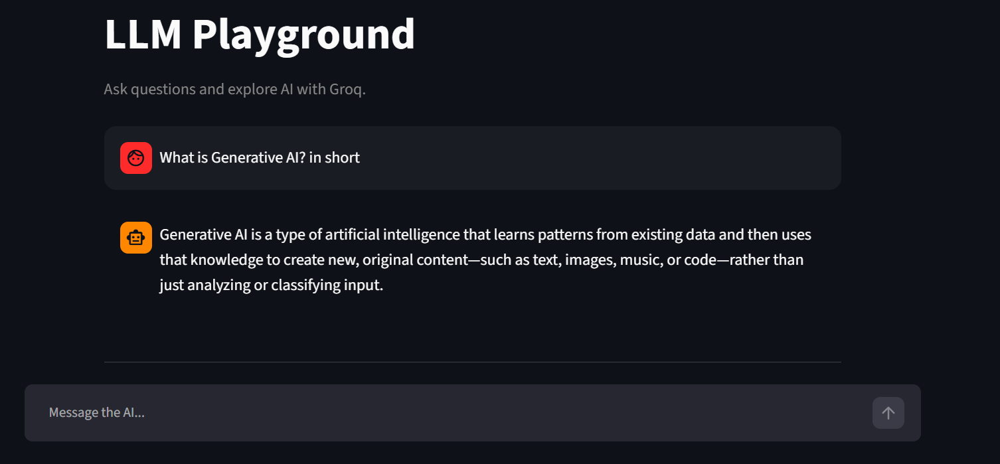
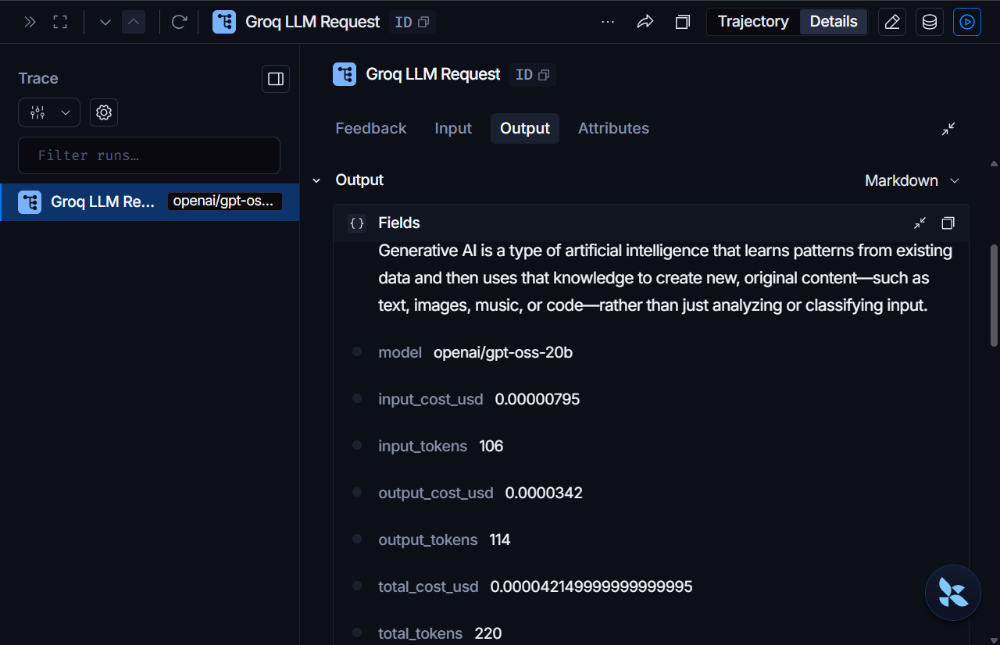
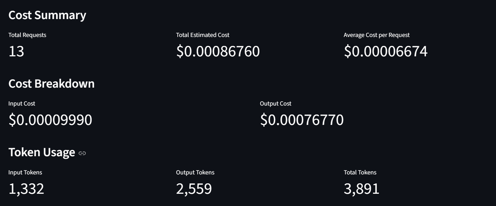
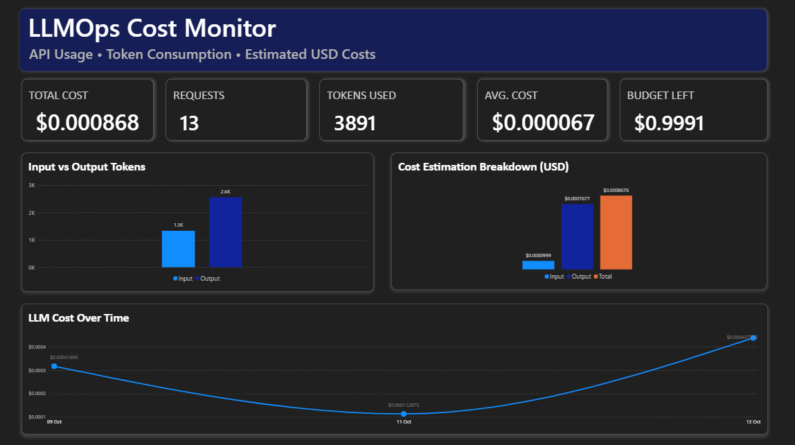

# LLMOps Cost Monitoring System

A Python-based LLMOps project that integrates a Groq-powered LLM chatbot, token usage tracking, estimated API cost monitoring, LangSmith tracing, and a Power BI analytics dashboard.

## Features
* **LLM Playground:** Interact with a Groq language model through a Streamlit chat interface.
* **Token Usage Tracking:** Capture input tokens, output tokens, and total tokens from API responses.
* **Cost Estimation:** Estimate input and output costs using configured per-million-token prices.
* **Usage Logging:** Store request usage and estimated costs in a CSV file.
* **Cost Monitor:** View request counts, token usage, estimated costs, and budget status.
* **Power BI Dashboard:** Analyze usage and cost metrics through an interactive report.
* **LangSmith Tracing:** Trace LLM operations for monitoring and debugging.

## Tech Stack
* Python
* Groq API
* Streamlit
* LangSmith
* Pandas
* Microsoft Power BI

## Project Structure
```text
llmops-cost-monitor/
├── app.py
├── llm_playground.py
├── groq_cost_tracker.py
├── usage_logger.py
├── usage_tracker.py
├── usage_logs.csv
├── .gitignore
└── README.md
```

Additional files may be present depending on your local setup.

## Getting Started
1. Clone or download this repository.

2. Create and activate a Python virtual environment.

3. Install the dependencies required by the project.

4. Create a `.env` file with your Groq and LangSmith configuration.

5. Run the chatbot:

   ```bash
   streamlit run llm_playground.py
   ```

6. Run the cost monitor in a separate terminal:

   ```bash
   streamlit run app.py
   ```

7. Open the Power BI report and connect or refresh it against the usage CSV as configured.

## Environment Variables
Configure your API keys locally in `.env`. Never commit this file to GitHub.

Keep `.env` excluded in `.gitignore`.

## Cost Estimation
Estimated request cost is calculated as:

```text
Input cost  = (Input tokens / 1,000,000) × Input price per million
Output cost = (Output tokens / 1,000,000) × Output price per million
Total cost  = Input cost + Output cost
```

Actual costs depend on the selected model, provider pricing, and usage. Estimates are only as accurate as the configured prices.

## 📸 Project Screenshots

### 1. LLM Chatbot Interface



### 2. LangSmith Tracing



### 3. LLM Cost Estimation



### 4. Power BI Dashboard




## Limitations
* Power BI may require a manual refresh to display new CSV records.
* Cost values are estimates based on configured token prices.
* The project requires valid API credentials to make live LLM requests.

## Security
Do not publish API keys, passwords, or other secrets. Review CSV logs before uploading them to a public repository.

Built as a hands-on project to explore LLMOps, usage tracking, cost estimation, tracing, and analytics.
